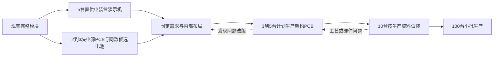

# 语音对讲：先做5台，再验证PCB和小批生产

更新：2026-11-20。当前安排：**先用完整开发板和现有模块装5台带外壳演示机，外接电源直供；备用电源并行做2～3块电源专用PCB，配相同完整料号的量产候选电池包。** 成品大电池UPS退出采购推荐，电源小板通过后再决定整机集成方式。

## 1. 三个阶段各验证什么

| 阶段 | 做什么 | 能验证什么 | 通过后做什么 |
| --- | --- | --- | --- |
| 第一阶段：5台模块演示机 | 完整ESP32开发板、自研4G板、现有音频模块，装盒和面板按钮；基础配置直供电 | 多台真实通话、装盒声音/回声、天线、长期插电、App和使用体验 | 确定需求、内部布局和声音问题，再确定PCB范围 |
| 第二阶段：3～5台PCB工程样机 | 按计划生产的硬件架构打样，验证焊接、电源和整机；备用电源在此阶段定型或继续独立模块 | 新PCB本身、供电峰值、烧录/测试接口、装配和散热；采用最终电池时验证备用流程 | 修订到可重复生产的版本，完成BOM和生产资料 |
| 第三阶段：10台生产试装，再到100台 | 工厂或另一位装配人员按同一套资料制作，逐台烧录、检查和真实通话 | 工艺、批次一致性、实际工费、返修、出厂测试与交付 | 按实际报价和验证结果扩大数量 |

第一阶段能提前发现产品问题，但不证明以后更换的PCB已经通过，也无法用5台推算量产良率。**如果最终主板要用ESP32-S3模组替代开发板，第二阶段就要验证该模组及其3.3V电源、去耦、启动/复位、USB/烧录等外围电路。** 只制作连接底板，验证范围就是该底板加现有模块。

备用电源与第一阶段装盒并行。按[集成备用电源打样与电池定型](集成备用电源打样与电池定型.md)做2～3块电源小板和2～3只同款候选电池包，验证电芯/保护板/线束及电源电路。完整型号与设计目前未冻结/实测，不继续采购大电池UPS作为集成验收对象。

## 2. 第一阶段采购清单

每台使用完整开发板/模块，因此其板上小电阻、电容、稳压和USB等器件已经包含在成品板里。下面的模块不是裸芯片，不需要另买这些板内器件贴装。

| 部件 | 5台净用量 | 本阶段要求 |
| --- | ---: | --- |
| ESP32-S3完整开发板 | 5块 | 与当前已跑通板型一致，不能仅按N16R8丝印换不同板；包含原板自身外围 |
| 自研ML307完整4G板 | 5块 | 保持已验证版本、板级电源入口和UART接法 |
| 匹配4G天线和天线连接线 | 5套 | 保持当前接头/频段；装盒后再测 |
| INMP441麦克风模块 | 5块 | 沿用当前3.3V供电和L/R接法 |
| MAX98357 I2S功放模块 | 5块 | 沿用当前5V供电、增益和控制脚接法 |
| 当前已验证喇叭 | 5只 | 尺寸、阻抗、功率按实物核对；与功放匹配 |
| 外部稳压适配器及电源线 | 5套 | 基础语音版从5V/3A测试供电起步，整机输出能力按5V/2A目标验证；2A适配器是否够由带载测试决定 |
| 现成ABS盒和内部固定支架 | 5套 | 先核实际内尺寸；开发板、4G、喇叭、按钮尾部和线缆均能放下 |
| 面板呼叫按钮 | 5只 | 常开自复位、不带灯；孔径、尾深按实物确定 |
| 连接线束/分支接线件 | 5套 | 沿用已跑通信号连接；电源用短粗线，明确极性和固定方式 |
| 螺丝、支柱、绝缘及线缆固定件 | 5套 | 板子/喇叭固定可靠，避免PCB背面碰螺柱或金属 |
| 标签和简单包装 | 5套 | 台号、硬件/固件版本、供电规格可识别 |
| SIM卡及服务 | 5份可用配置 | 卡型和运营商匹配；流量/服务器费用单列 |
| 可选生命体征模块 | 基础款0块 | 先复用已有1块做扩展演示，不要求新买5块 |
| 备用电源 | 基础款0套；并行电源PCB/电池各2～3另计 | 用同款候选电池和准备集成的电路打样验证 |

基础硬件前6项继续采用用户实际约60元/套的合计口径，不重复按单件零售价相加。已有可用库存按实际数量扣减。新按钮的GPIO、上下拉和操作行为须核对当前固件；本方案文档没有修改按键代码，不能认定随意接GPIO即可呼叫。

直供电时，5V分支只接确认支持5V的板级入口，麦克风仍用3.3V；所有模块共地。开发板电脑USB与外接5V同时使用前核对防倒灌。雷达扩展需另外验证模块引脚处电压和纹波，基础版适配器的结论不自动覆盖雷达。

## 3. 第一阶段现金预算

这是5台全部新购、自行装配和开孔的预算；除基础60元组合来自用户实购，其他数值尚非供应商报价。

| 项目 | 每台预算（元） | 5台（元） |
| --- | ---: | ---: |
| 原基础语音硬件组合 | 60 | 300 |
| 合格适配器和电源线 | 25 | 125 |
| ABS外壳 | 8 | 40 |
| 面板按钮 | 2 | 10 |
| 新增线束/分支接线件 | 3 | 15 |
| 固定、绝缘材料 | 3 | 15 |
| 标签及简单包装 | 2 | 10 |
| 设备小计 | **103** | **515** |
| 批次采购运费预算 | — | 30 |
| 小件补料/损耗预算 | — | 20 |
| 基础5台合计 | — | **565** |

可先给基础5台材料预留**700元额度**，不是商家报价或全部产品开发费用。已有1套完整可用基础硬件时，按上述预算扣60元；其余库存按实际扣减。

此表没有电池、UPS、PCB、钢网、SMT开机/贴片费；自行装配开孔的现金工费记0，但仍花时间。若外包装配、开孔/支架，或需新买工具，按实际报价另加。SIM/流量、服务、结构/硬件设计及后续改板单列。

并行电源试验总投入＝基础5台实际支出＋**2～3块电源PCB设计/复核/加工＋2～3只量产候选电池包＋必要工具/测试**的实际报价。不要再加大电池成品UPS费用；电源小板费用未报价，旧底板材料参考不能代替完整开发价。原[约1000元的5台预算](首版5台与100台成本.md)属于旧完整连接底板配置，不能与565元直接相加。

## 4. 第一阶段通过条件

建议起点，不是已完成测试：

- 5台分别能够联网，并用不同设备身份完成App呼入和按钮呼出；重复接听/挂断/拒接/超时后仍能再次通话。
- 先每台各完成一次30分钟双向通话，再选设备做2小时持续通话和72小时插电循环观察，记录失败和恢复情况。
- 装盒后按实际使用距离听清语音，检查音量、回声、啸叫、声孔、天线与温升。
- 待机和通话期间分别拔插主电，直供版记录断电和复电恢复行为；电源小板配候选电池试验记录是否保持运行，两种配置分开填写。
- 另一位人员照接线/装配资料能装出至少1台，操作时不需要你口头解释每个步骤。

通过后才能认为模块演示机具备进入PCB设计的依据。备用电源、后台来电或其他功能未验证时如实列为未通过，不用一次通话成功替代完整测试。

## 5. PCB打样前确定的事

固定外壳内空间、模块和喇叭规格、量产板是否替换开发板、基础版是否带电池、备用模式和电源输出目标；保留可选雷达连接与结构空间。若备用电路暂未定型，可将其做成独立模块接口，空间和电流按明确规格预留，后续整机仍要验证。

计划保留的独立4G/音频等模块一般可复用；若新板改用ESP32模组或直接贴音频芯片，相应旧开发板/模块可留作测试，但不能保证整套都搬入最终产品。同版PCB通过第二、三阶段后可以继续生产100台；新批次制造和开机费仍需支付。

**当前已有的KiCad电源底板和贴片资料属于工程草稿，尚未布线/实测。第一阶段先不用它们下单。**
